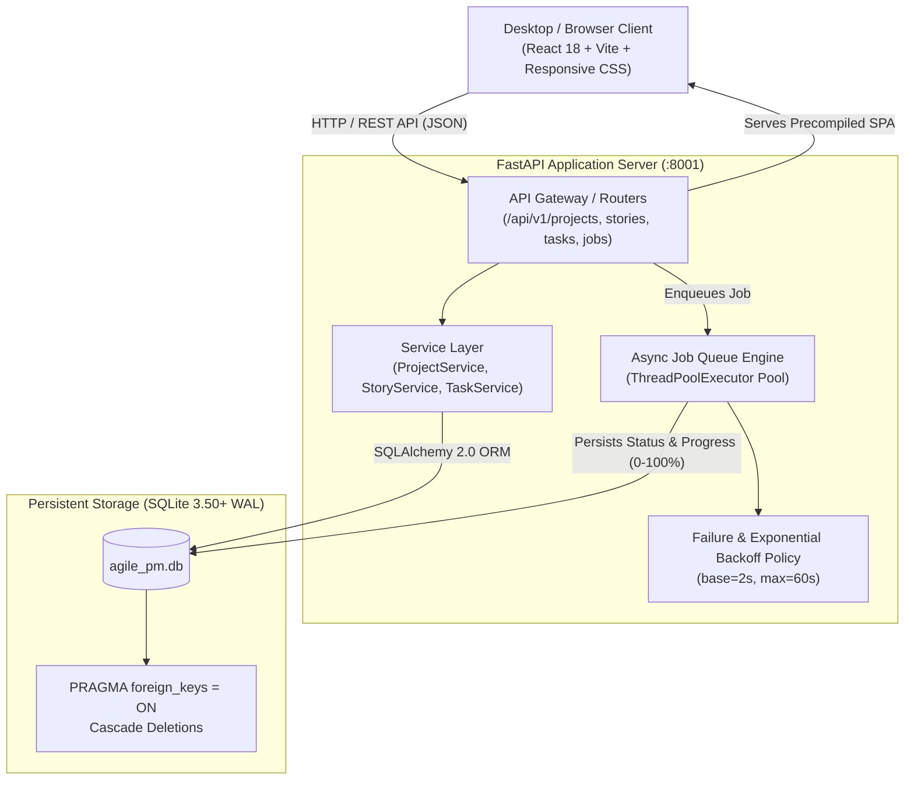

# System Architecture & Technical Design

## 1. System Overview

**SprintSync** is a full-stack agile project management system designed for small engineering teams (3–10 members). It provides work breakdown and tracking across a strict three-level hierarchy:

```
[Project] ── (1:N) ──> [User Story] ── (1:N) ──> [Task]
```

The system combines a reactive Single Page Application (SPA) frontend with a high-throughput, type-safe REST API and an in-process, fault-tolerant asynchronous background task processor.

---

## 2. Architecture Diagram



---

## 3. Layer Breakdown

### A. Presentation Layer (Frontend)
- **Framework**: React 18, Vite 5.
- **Views**:
  - **Tree Hierarchy**: Accordion breakdown with progress rollups, acceptance criteria view, and inline child creation.
  - **Agile Kanban Board**: 4-column visual board (`Backlog/Todo`, `In Progress`, `In Review`, `Done`) with single-click status transitions and dual view mode (Stories or Tasks).
  - **Sprint Analytics**: Real-time velocity tracker, story point distribution, and team member workload meters.
  - **Audit Activity Log**: Chronological timeline of all system actions.
  - **Async Workflows Center**: Real-time drawer tracking background tasks, execution progress, failure simulation, and manual retries.

### B. API & Routing Layer (Backend)
- **Framework**: FastAPI (Python 3.13), Starlette.
- **Validation**: Pydantic v2 schemas enforcing strict typing, bounds checking, and input sanitization.
- **Documentation**: Auto-generated interactive Swagger UI at `/docs` and ReDoc at `/redoc`.

### C. Business Logic & Service Layer
- **Decoupled Architecture**: Routers delegate all entity manipulation, business rules, key generation (`CORE-1`, `CORE-1-T1`), and metric calculation to dedicated service classes (`ProjectService`, `StoryService`, `TaskService`).
- **Audit Logging**: All write operations emit audit records into `audit_logs` table.

### D. Asynchronous Background Execution Engine
- **Engine**: In-process `ThreadPoolExecutor` worker with dedicated SQLite transaction sessions.
- **Lifecycle Management**:
  - `PENDING`: Task registered in database.
  - `PROCESSING`: Worker thread picked up task, updating live progress (0% -> 100%).
  - `RETRYING`: Transient error encountered; exponential backoff computed and next attempt scheduled.
  - `COMPLETED`: Result artifact (JSON/Markdown) saved to database with completion timestamp.
  - `FAILED`: Max retries exceeded; full stack trace logged to dead-letter state for inspection and manual retry.

---

## 4. Work Item Hierarchy & Rollup Logic

1. **Project**:
   - `total_stories`: Count of child stories.
   - `total_points`: Sum of all story points across child stories.
   - `completed_points`: Sum of story points for stories in `DONE` status.
   - `progress_percentage`: `(completed_points / total_points) * 100`.
2. **User Story**:
   - `task_count`: Count of nested tasks.
   - `completed_task_count`: Tasks with status `DONE`.
   - `progress_percentage`: `(completed_task_count / task_count) * 100`.
3. **Task**:
   - Atomic unit of work with status `TODO`, `IN_PROGRESS`, `IN_REVIEW`, `DONE`, `estimated_hours`, and `logged_hours`.
