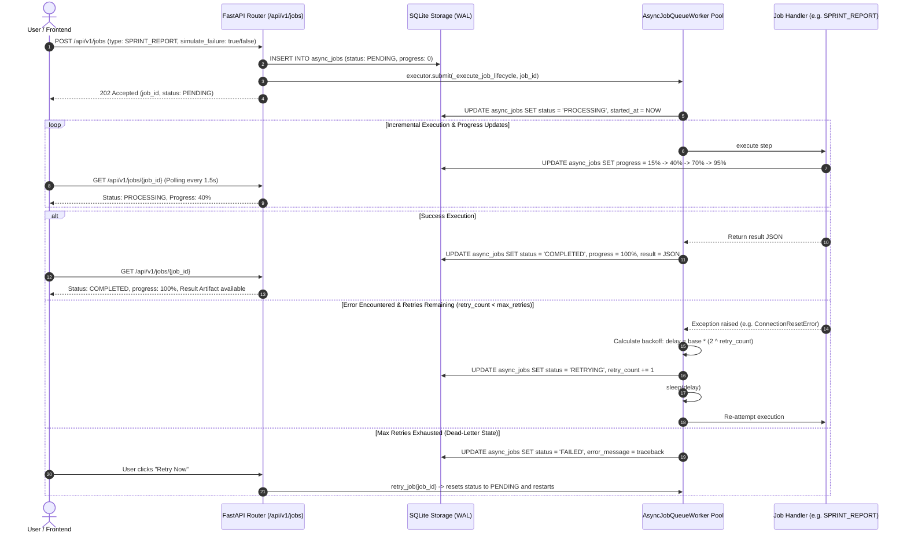

# Asynchronous Workflow, Worker Architecture & Failure Handling

## 1. Overview & Objective

The assignment requires:
> *"Include at least one asynchronous or background workflow (e.g., notifications, reminders, report generation, or background processing). Explain your design and handling of failures or retries."*

SprintSync provides a dedicated asynchronous worker engine capable of processing long-running computational jobs, generating analytical digests, and safely recovering from transient errors via an **exponential backoff retry policy**.

---

## 2. Asynchronous Architecture & Lifecycle Flow

---

## 3. Real-World Background Workflows Implemented

SprintSync implements two background workflows:

### A. Asynchronous Sprint Digest & Executive Report (`SPRINT_REPORT`)
- **Purpose**: Aggregates all hierarchical work items (Project -> Stories -> Tasks), calculates story point velocity, estimated vs logged hours variance, and compiles executive insights.
- **Why Asynchronous?**: Avoids blocking HTTP worker threads when computing multi-project aggregates, formatting report artifacts, or performing external webhook distributions.
- **Progress Tracking**: Real-time progress updates are emitted at key computational stages (15% -> 40% -> 70% -> 95% -> 100%).

### B. Team Workload & Bottleneck Risk Scanner (`WORKLOAD_AUDIT`)
- **Purpose**: Traverses all active stories and sub-tasks to detect capacity bottlenecks (e.g., developers with > 20 estimated hours) or unassigned high-priority work.

---

## 4. Failure Handling & Exponential Backoff Policy

Resiliency is enforced by `app.workers.failure_policy.FailurePolicy`:

### Exponential Backoff Formula
$$\text{delay} = \min\left(\text{max\_delay},\, \text{base\_seconds} \times 2^{\text{retry\_count}}\right)$$

Where:
- $\text{base\_seconds} = 2.0\text{ seconds}$
- $\text{max\_delay} = 60.0\text{ seconds}$
- $\text{DEFAULT\_MAX\_RETRIES} = 3$

| Attempt Number | Retry Count | Backoff Delay Before Next Attempt |
|---|---|---|
| Attempt 1 (Initial failure) | 1 | $2.0 \times 2^0 = 2.0\text{ seconds}$ |
| Attempt 2 (Second failure) | 2 | $2.0 \times 2^1 = 4.0\text{ seconds}$ |
| Attempt 3 (Third failure) | 3 | $2.0 \times 2^2 = 8.0\text{ seconds}$ |
| Attempt 4 (Final failure) | 4 | Max retries exceeded $\rightarrow$ Transitions to `FAILED` |

---

## 5. Verifying the Failure & Retry Mechanism in the UI

To make evaluation easy and verifiable:
1. Open the **Async Jobs** drawer in the UI (top navigation bar).
2. Check the box: **"Simulate Failure & Automatic Retry"**.
3. Click **"Generate Sprint Digest"**.
4. Observe the worker:
   - Attempt 1 starts $\rightarrow$ encounters simulated transient error $\rightarrow$ switches status to `RETRYING (Attempt 1)` with amber pulsing badge.
   - Waits for exponential backoff (2.0s).
   - Attempt 2 runs $\rightarrow$ encounters simulated error $\rightarrow$ switches to `RETRYING (Attempt 2)`.
   - Waits for exponential backoff (4.0s).
   - Attempt 3 runs $\rightarrow$ recovers and transitions to `COMPLETED (100%)`!
5. If max retries are exceeded, the job transitions to `FAILED` (Dead-letter state), displays the stack trace, and exposes a **"Retry Now"** button for immediate manual recovery.
