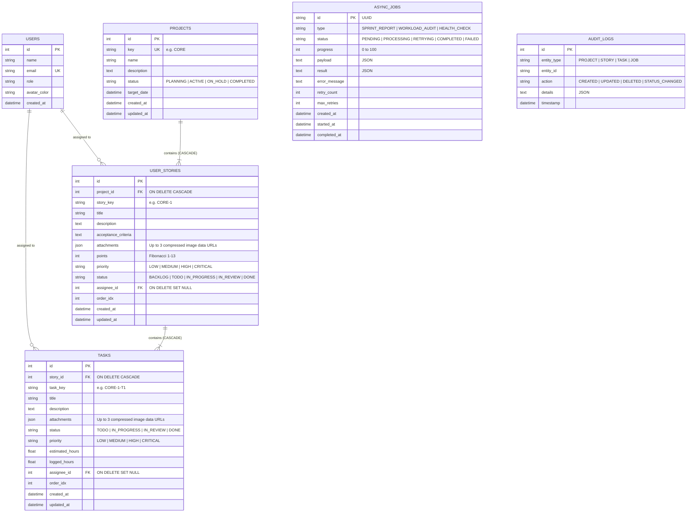

# Database Schema Documentation

## 1. Entity-Relationship Diagram (ERD)

---

## 2. Table Specifications

### A. `projects`
| Column | Type | Constraints | Description |
|---|---|---|---|
| `id` | INTEGER | PRIMARY KEY, AUTOINCREMENT | Unique project identifier |
| `key` | VARCHAR(10) | UNIQUE, NOT NULL, INDEXED | Short project key (e.g. CORE) |
| `name` | VARCHAR(150) | NOT NULL | Project title |
| `description` | TEXT | NULLABLE | Sprint goal / project description |
| `status` | VARCHAR(30) | NOT NULL, DEFAULT 'ACTIVE' | Lifecycle state |
| `target_date` | DATETIME | NULLABLE | Sprint / release target deadline |
| `created_at` | DATETIME | DEFAULT UTC | Creation timestamp |
| `updated_at` | DATETIME | DEFAULT UTC, ON UPDATE UTC | Last updated timestamp |

### B. `user_stories`
| Column | Type | Constraints | Description |
|---|---|---|---|
| `id` | INTEGER | PRIMARY KEY, AUTOINCREMENT | Unique story identifier |
| `project_id` | INTEGER | FOREIGN KEY (`projects.id`) ON DELETE CASCADE | Parent project |
| `story_key` | VARCHAR(20) | NOT NULL, INDEXED | Human-readable story key (`CORE-1`) |
| `title` | VARCHAR(200) | NOT NULL | Story summary |
| `description` | TEXT | NULLABLE | User story context |
| `acceptance_criteria`| TEXT | NULLABLE | Definition of Done checklist |
| `attachments` | JSON | NOT NULL, DEFAULT `[]` | Compressed reference images |
| `points` | INTEGER | DEFAULT 3 | Agile estimation points (1, 2, 3, 5, 8, 13) |
| `priority` | VARCHAR(20) | DEFAULT 'MEDIUM', INDEXED | Priority level |
| `status` | VARCHAR(30) | DEFAULT 'BACKLOG', INDEXED | Kanban column state |
| `assignee_id` | INTEGER | FOREIGN KEY (`users.id`) ON DELETE SET NULL | Story owner |
| `order_idx` | INTEGER | DEFAULT 0 | Sorting index |
| `created_at` | DATETIME | DEFAULT UTC | Creation timestamp |
| `updated_at` | DATETIME | DEFAULT UTC, ON UPDATE UTC | Last updated timestamp |

### C. `tasks`
| Column | Type | Constraints | Description |
|---|---|---|---|
| `id` | INTEGER | PRIMARY KEY, AUTOINCREMENT | Unique task identifier |
| `story_id` | INTEGER | FOREIGN KEY (`user_stories.id`) ON DELETE CASCADE | Parent user story |
| `task_key` | VARCHAR(30) | NOT NULL, INDEXED | Human-readable task key (`CORE-1-T1`) |
| `title` | VARCHAR(200) | NOT NULL | Task description |
| `attachments` | JSON | NOT NULL, DEFAULT `[]` | Compressed reference images |
| `status` | VARCHAR(30) | DEFAULT 'TODO', INDEXED | Status (`TODO`, `IN_PROGRESS`, `IN_REVIEW`, `DONE`) |
| `priority` | VARCHAR(20) | DEFAULT 'MEDIUM' | Priority level |
| `estimated_hours` | FLOAT | DEFAULT 2.0 | Estimated effort in hours |
| `logged_hours` | FLOAT | DEFAULT 0.0 | Actual spent hours |
| `assignee_id` | INTEGER | FOREIGN KEY (`users.id`) ON DELETE SET NULL | Task owner |
| `order_idx` | INTEGER | DEFAULT 0 | Sorting index |
| `created_at` | DATETIME | DEFAULT UTC | Creation timestamp |
| `updated_at` | DATETIME | DEFAULT UTC, ON UPDATE UTC | Last updated timestamp |

### D. `async_jobs`
| Column | Type | Constraints | Description |
|---|---|---|---|
| `id` | VARCHAR(36) | PRIMARY KEY | UUID identifier |
| `type` | VARCHAR(50) | NOT NULL, INDEXED | Job type (`SPRINT_REPORT`, `WORKLOAD_AUDIT`) |
| `status` | VARCHAR(20) | DEFAULT 'PENDING', INDEXED | Execution status |
| `progress` | INTEGER | DEFAULT 0 | Progress percentage (0–100%) |
| `payload` | TEXT | NULLABLE | JSON parameters passed to worker |
| `result` | TEXT | NULLABLE | JSON output produced by completed job |
| `error_message` | TEXT | NULLABLE | Traceback / error log upon failure |
| `retry_count` | INTEGER | DEFAULT 0 | Number of attempts performed |
| `max_retries` | INTEGER | DEFAULT 3 | Retry limit |
| `created_at` | DATETIME | DEFAULT UTC | Queue registration timestamp |
| `started_at` | DATETIME | NULLABLE | Worker pickup timestamp |
| `completed_at` | DATETIME | NULLABLE | Completion or termination timestamp |

---

## 3. SQLite Integrity & Concurrency Configuration

SQLite is used with two critical pragmas enabled on every connection:
1. `PRAGMA foreign_keys = ON;`:
   Enforces relational referential integrity. Deleting a `Project` automatically and atomically cascade-deletes all associated `UserStory` and child `Task` records.
2. `PRAGMA journal_mode = WAL;`:
   Enables Write-Ahead Logging. This allows multiple concurrent reader threads while the background async worker writes updates, avoiding database lock contentions.
